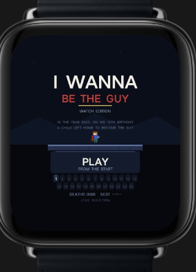
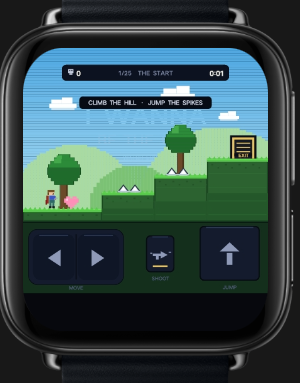
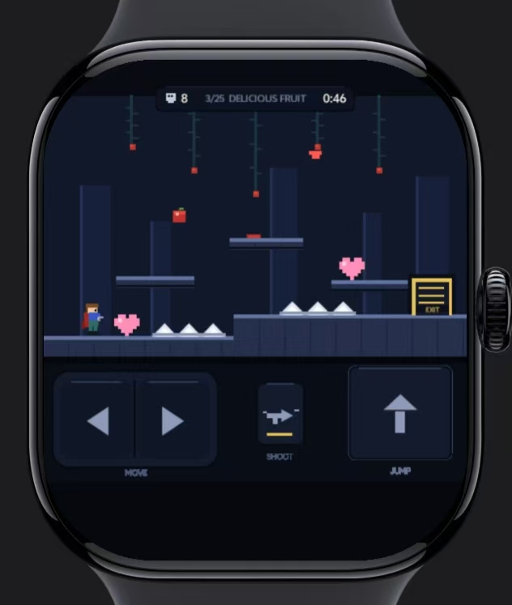
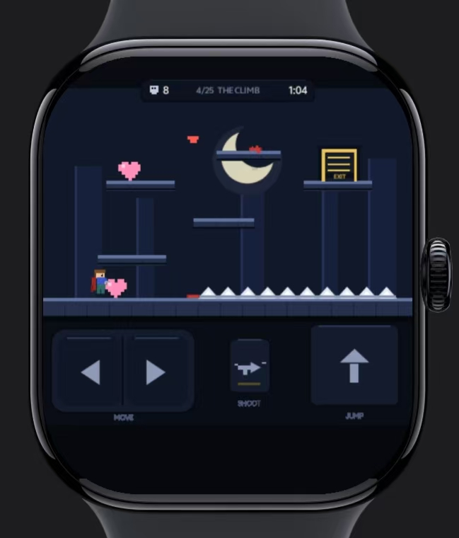

# IWanna Lite

一款面向智能手表的像素风平台跳跃游戏。操控角色通过关卡，躲避尖刺与机关，收集关卡物品；在表盘上使用方向、射击和跳跃按键完成挑战。

## 玩法简介

- **移动**：使用左右方向键控制角色前进或后退。
- **跳跃**：把握时机越过平台落差和尖刺。
- **射击**：使用射击按键应对关卡中的障碍。
- **闯关收集**：观察关卡提示，收集物品并继续向出口前进。

## 游戏截图

| 标题页 | 手表操作画面 |
| --- | --- |
|  |  |

| Delicious Fruit 关卡 | The Climb 关卡 |
| --- | --- |
|  |  |

## 下载

- [下载 RPK 安装包](downloads/com.sci.iwanna-1.0.0-debug.rpk)

## 安装包信息

- 包名：`com.sci.iwanna`
- 应用名称：`I Wanna Be The Guy`
- 版本：`1.0.0`（versionCode `17`）
- 设备类型：方形表盘、圆形表盘
- 构建类型：Debug

仓库收录的是提供的 RPK 安装包和演示截图，不包含游戏源代码。安装需要兼容 RPK 的手表运行环境。
